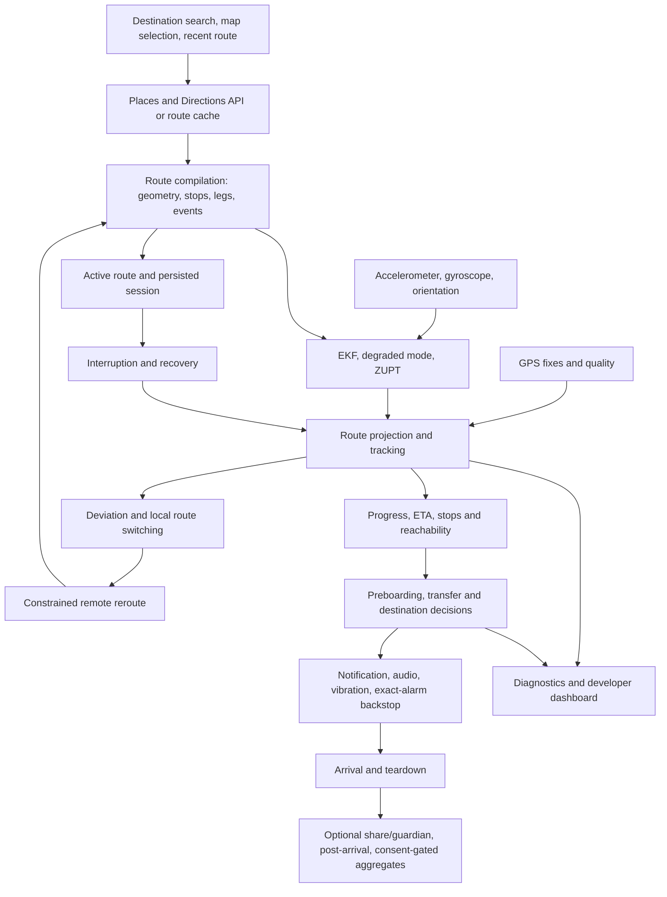

# Data and state: an end-to-end map

Prepared 20 September 2026 against the captured local-work lineage through
`a3ce671`. This maps the program's data contracts. It does not imply that a
production dataset or every external service is included in the sale.

## Data dictionary and custody

| Record | Producer and important fields | Transformations and consumers | Persistence / export boundary |
|---|---|---|---|
| Destination selection | Home, map tap or Places result; label, place ID when available, latitude/longitude | Metro endpoint policy may select a station; feeds route request and recent destinations | Local recent-location store; remote requests use configured Maps backend |
| Places session | Search query, location/country bias, session token | Autocomplete suggestions then place-details resolution; token ends after selection | Transient request context; token is not a user account |
| Directions response | Provider/cache; routes, legs, steps, duration, distance, encoded polylines, transit details | `RouteSessionManager` and `transfer_utils` derive geometry, segment domains, stops and events | Route cache plus active-session snapshot; provider-derived data remains separately attributed |
| Route geometry | Decoded points and cumulative meter distances | GPS projection and EKF use distance along the route; line metadata constrains stops and speed ceilings | In-memory registered route; reconstruction from saved directions |
| Route registry entry | Route key, geometry, events and cached payload | Active-route selection, local candidates and refresh handling; captured work distinguishes active-key payloads and generation changes | Bounded in-memory registry; not a history of users' trips |
| Alarm contract | Mode (`distance`, `time`, `stops`), threshold, destination, transit mode and settings | Shared captured validator checks feasibility; evaluator and reroute constraints consume the same intended contract | Session snapshot; retained until teardown/recovery policy clears it |
| GPS fix | Location stream; position, accuracy, speed, bearing and timestamps | Acceptance gates, innovation handling, projection, GPS health and reachability anchoring | Transient runtime; optional field diagnostics are a separate flag |
| IMU sample | Accelerometer/gyroscope streams and timing | Tilt/motion processing, EKF prediction, ZUPT; also a separate anti-theft detector | Transient runtime; raw logging is explicitly configured for experiments |
| EKF state | Along-route position/speed/bias and covariance | GPS corrects; IMU predicts; zero-velocity measurements constrain speed; station association may constrain position | In-memory with optional persisted state; uncertainty is part of the state, not a confidence guarantee |
| Station association | ZUPT evidence, station distances, progress uncertainty and dwell | Candidate selection, confidence/index gates, then stop progress event | Derived event; station identity is not established by ZUPT alone |
| Reachability state | Trusted anchor, elapsed monotonic time, route length and speed bound | Maximum possible route progress feeds alarm timing alongside estimated progress | Derived model state; guarantee is conditional on anchor/time/speed assumptions |
| Deviation evidence | Lateral offset, speed, heading, route hint and sustain time | Hysteresis → local switch candidates → online/cooldown policy → constrained reroute or termination | Transient state plus diagnostics; actual field precision is not measured by synthetic crossings |
| Alarm event | Stable route/leg/event identity, event type and destination/boarding context | Deduplication, setting gates, sound/vibration/notification, backstop and observer hooks | Fired IDs/session state prevent repeated alerts; terminal teardown clears active tracking |
| Recovery snapshot | Active/paused/alarm flags, route contract, directions, timing and optional EKF state | Foreground/background startup validates freshness and reconstructs active state | SharedPreferences; captured recovery policy handles stale snapshots |
| Route memory | Coarse route/destination/mode/line signature, frequency and origin context | Frequent/recents ranking and widget entry | Local Hive data; distinct from recent destination autocomplete |
| Share session | Opaque ID, capabilities, mode/status, labels, creation/expiry and optional backend ID | Live transport, share page, followed-ride poll, arrival/revocation | Local storage and configured share backend; current snapshot only, no trajectory array in model |
| Share snapshot | Latest position rounded to five decimals and optional ETA | Follower status display | Precise enough to be personal location; not anonymous merely because rounded |
| Guardian contact | Selected contact channel/address, enabled state and active journey | User-mediated composer or separately injected automatic sender | Local contact state; real contacts are not part of the code corpus |
| Entitlement | Permanent ownership, temporary expiry, pending state and verified store result | Policy getters, paywall and optional feature gates | Local entitlement state; store tokens/credentials are not sale assets |
| Purchase verification | Product ID and purchase token from store; expiry/state from Publisher API | Backend verification then client grant/update; restore and late events reconcile state | External store account/credentials excluded; tests inject mocked responses |
| Telemetry event | Typed outcome/health/error helpers; type, timestamp, property map | JSON serialization, bounded buffer, rotating file and optional HTTP sinks | Diagnostics are separate from mobility consent and field recordings; no actual user telemetry sold by this code manifest |
| OD contribution | Completed-trip endpoints and time after current-version consent | Station binning → local date/hour/day type → cap/reserve → aggregate cell | Local Hive; withdrawal erases local aggregate state and records erasure |
| Release candidate | Cell key, noisy candidate count, contributor count and method metadata | Candidate sink interface and backend merge scaffold | Default no-op sinks/egress-disabled configuration; not a released population dataset |
| Released aggregate | Backend cell/device sets; suppression/noise output | Flow, catchment and summary responses | In-memory backend methodology; no live aggregation business or formal privacy proof is included |
| Synthetic fixtures | Generator-authored GPS/IMU scenarios, with `synthetic: true` | Replay, scale and deterministic regression tests | Replay inputs retained with provenance caveat; scale inputs withheld because their geography came from the mixed catalog |
| Experimental recordings | Phone sensor CSVs and related analysis inputs; founder says friends' phones | Offline replay, synchronization, stop/position experiments | Separate optional bundle; manifest explains capture gaps and privacy transformations; not part of default code license |

## Critical invariants across the boundaries

1. **One active journey context:** destination, route key, geometry and alarm
   contract must agree. Generation/ACK guards in the local-work capture address
   stale route callbacks and incomplete background handoffs.
2. **Distinct distance domains:** geometric route length, provider distance,
   cumulative progress, per-leg distance and distance-to-destination cannot be
   substituted silently. The route-compilation and alarm tests are entry points
   for examining those conversions.
3. **Uncertainty survives conversion:** a finite EKF position is not necessarily
   an accurate one. ZUPT constrains velocity; station association supplies a
   separate position hypothesis. A conservative reachability bound serves a
   different purpose from the best location estimate.
4. **Optional effects follow the core transition:** sharing, guardian,
   monetization, diagnostics and aggregation have their own failure handling.
   Source comments and tests express their independence from alarm delivery.
5. **A model type is not a rights grant:** a provider-derived station list,
   synthetic route and recorded journey have different provenance. The file
   manifest and optional-data register carry that distinction into delivery.

## How a buyer can use the map

For code-comprehension tasks, start with a data row and trace its producer,
storage and consumers through the source navigation index. For debugging,
choose an authentic change and compare the preceding state with its regression
test. For evaluation, pin the source revision and exact fixtures before
assigning an expected outcome. The verified historical ZUPT example supplies
one such fail-to-pass pair; it is separate from the open-ended research story.
